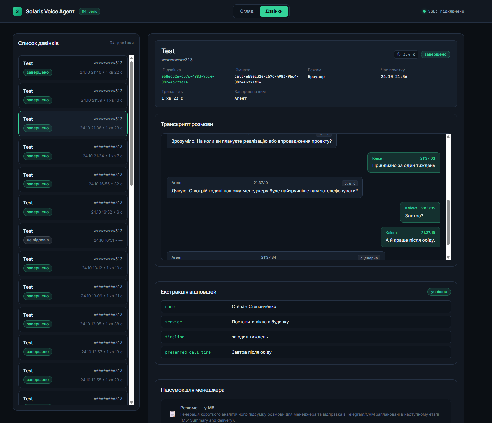
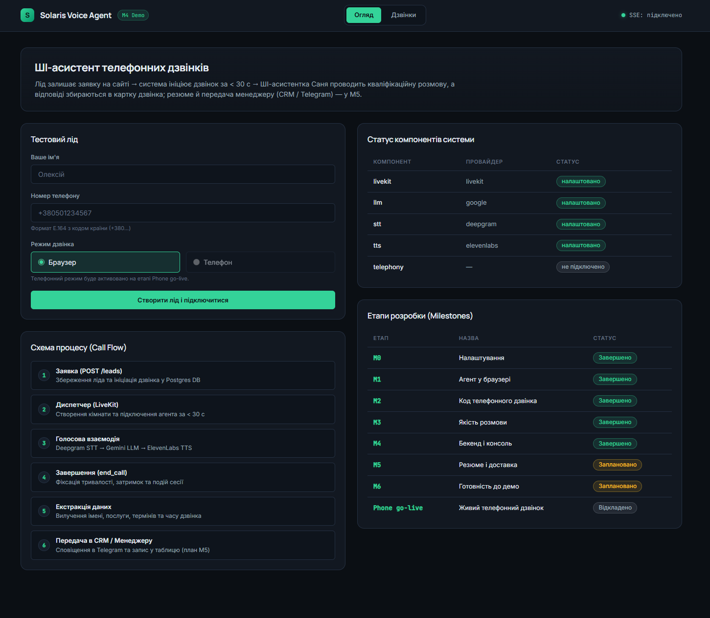
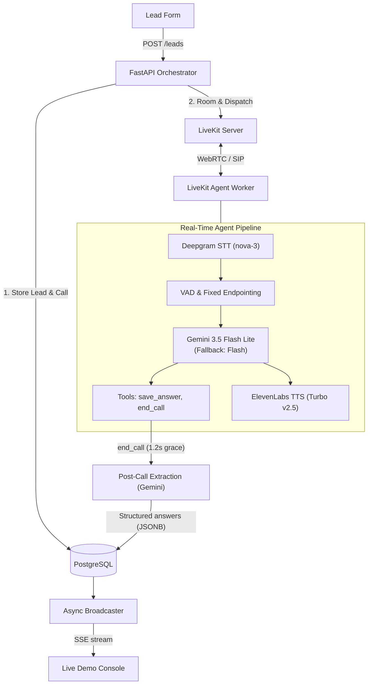
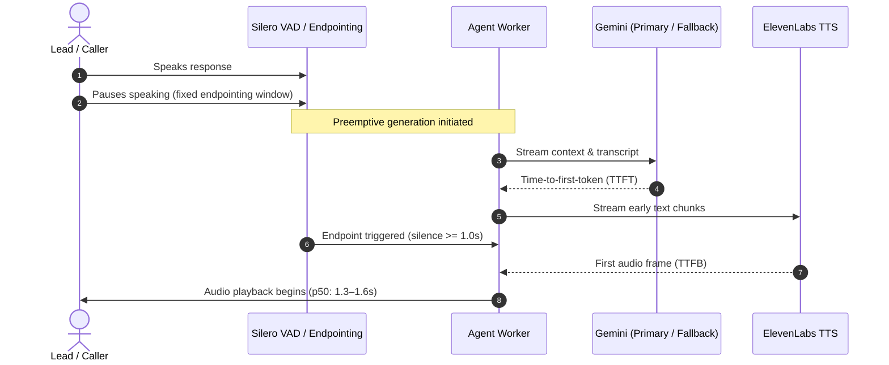

# Voice Callback Agent

[](https://github.com/strixxjs/voice-callback-agent/actions/workflows/ci.yml)
[](https://www.python.org/)
[](https://fastapi.tiangolo.com/)
[](https://livekit.io/)

An outbound AI voice agent that automatically calls website leads within ~30 seconds, conducts a natural qualifying conversation in Ukrainian, and delivers structured post-call answers to a sales manager.

---

## Key Numbers

| Metric | Measured Value | Verification & Source |
| :--- | :--- | :--- |
| **Response Latency (p50)** | **1.3–1.6 s** | Measured e2e user-speech-end to agent-audio; normal Gemini state (`docs/m3-test-log.md`) |
| **Answer Extraction** | **4/4 fields (100%)** | Structured post-call JSON extraction across benchmark calls when caller answered (`docs/m3-test-log.md`) |
| **Lead-to-Call Speed** | **< 30 s target** | Immediate LiveKit room provisioning & background agent dispatch on `POST /leads` |
| **Automated Tests** | **149 passing** | Unit, API, async state machine, and metric tests run via `pytest` in ~7 s |
| **CI Automation** | **Passing** | GitHub Actions (`ci.yml`): Ruff formatting, linting, and full test suite on Python 3.12 |

> **Project Status:** Built as a production-grade demo for a prospective client; development is currently paused. The browser mode works end-to-end with real-time WebRTC audio, voice qualification, and a live SSE monitoring console. The outbound telephony (SIP) path is fully implemented and unit-tested (`scripts/call_me.py`, `agent/telephony.py`), but live telco carrier calls are deferred pending client confirmation.

---

## Screenshots


*Live call inspection card showing real-time transcript streaming, structured answer extraction, and per-turn latency breakdowns.*


*Console overview with lead submission, instantaneous WebRTC test connection, and component configuration status.*

---

## How It Works

### System Architecture



### Conversational Turn Execution



---

## Engineering Highlights

- **Turn-Taking & Latency Tuning**:
  - *Problem:* Default dynamic turn detection caused sluggish ~2.5+ s pauses or cut off callers during brief mid-sentence hesitations.
  - *Solution:* Configured fixed VAD endpointing (`min_delay: 1.0s`, `max_delay: 3.0s`) paired with `preemptive_generation: true` to overlap LLM token generation with caller silence, plus worker pre-warming (`prewarm()`).
  - *Result:* Consistent p50 end-to-end response latency of 1.3–1.6 s under normal Gemini API conditions without speaking over 1.5 s mid-phrase pauses.

- **End-Call Grace Window**:
  - *Problem:* In voice calls, leads often formulate final answers across multiple clauses separated by pauses (e.g., *"Tomorrow... at 3 PM"*). Immediate disconnects drop the final response.
  - *Solution:* Implemented a 1.2 s grace period in `end_call` with active caller speech monitoring and a 3.0 s noise timeout cap (`END_CALL_NOISE_TIMEOUT_CAP`).
  - *Result:* Zero lost final words across all benchmark test runs, reliably capturing split answers like *"Сьогодні… о п'ятнадцятій"*.

- **Interruptible Goodbye with Noise Filter**:
  - *Problem:* Callers frequently interject during the agent's farewell with last-minute questions (pricing, timeline) or name corrections.
  - *Solution:* Configured `allow_interruptions=True` during the closing phrase with transcript verification to distinguish real speech from ambient noise. If interrupted by real speech, termination cancels, the agent answers, and upon concluding uses a concise fallback (`short_goodbye: "До побачення!"`).
  - *Result:* Graceful recovery from farewell interruptions without repeating long greeting/outro scripts.

- **SDK Latency Measurement Correction**:
  - *Problem:* When user answers spanned multiple segments (split turns or post-tool execution), LiveKit SDK's `ChatMessage.metrics.e2e_latency` anchored back to the initial segment, falsely inflating measured latency by seconds.
  - *Solution:* Implemented `SessionMetricsCollector` to calculate measured latency from the `stopped_speaking_at` timestamp of the *last* user utterance before agent speech, preserving raw SDK metrics (`sdk_e2e`) for diagnostics and logging divergence warnings when delta exceeds 0.3 s.
  - *Result:* Clean, verifiable per-turn latency data without artifactual inflation on split turns.

- **Resilient LLM Fallback Pipeline**:
  - *Problem:* Free-tier and cloud LLM APIs experience transient 503 errors and rate limits during peak hours.
  - *Solution:* Wrapped primary (`gemini-3.5-flash-lite`) and secondary (`gemini-3.5-flash`) models with LiveKit's `FallbackAdapter` (10.0 s attempt timeout), backed by an uninterruptible spoken apology phrase (`error_phrase`) and graceful session termination (`aclose()`) if all models fail.
  - *Result:* Zero silent hangs or uncaught exceptions during upstream provider outages.

- **Structured Post-Call Extraction**:
  - *Problem:* In-call function calling (`save_answer`) can miss fields when users answer out of order, and converting relative colloquial times (e.g., *"tomorrow afternoon"*, *"завтра о другій"*) into absolute ISO timestamps often introduces date errors.
  - *Solution:* Augmented in-call tools with an asynchronous post-call extraction step using Gemini targeting a strict Pydantic JSON schema (`answers` and `missing` keys), explicitly configured to retain raw spoken phrasing for `preferred_call_time`.
  - *Result:* 100% extraction accuracy (4/4 fields) across answered benchmark calls.

- **Zero-PII Leakage Architecture**:
  - *Problem:* Ingestion of caller phone numbers risks leaking sensitive PII into application logs, client URLs, error traces, or third-party LLM prompts.
  - *Solution:* Applied E.164 phone normalization with systematic masking (`mask_phone_number`, e.g., `+48123456789` -> `*********789`) across logs, DB events, and API responses. LiveKit rooms use random UUIDs (`call-<uuid>`) without phone metadata, and a custom FastAPI handler strips echoed input from HTTP 422 error payloads.
  - *Result:* Full auditability with zero plain-text phone numbers exposed in logs or frontend payloads.

- **Comprehensive Automated Test Suite**:
  - *Problem:* Real-time voice agents combine concurrent state machines, WebRTC events, audio playout, and network fallbacks that are fragile under change.
  - *Solution:* Built 149 automated tests across 10 modules mocking LiveKit RTC sessions, Twirp API errors, SSE broadcasting, and LLM edge cases, integrated into GitHub Actions CI.
  - *Result:* 100% deterministic test execution in ~7 seconds without incurring third-party API costs.

---

## Tech Stack

| Component | Technology | Version | Rationale |
| :--- | :--- | :--- | :--- |
| **Backend Framework** | FastAPI | >= 0.159.0 | High-concurrency async REST API, Pydantic v2 validation, SSE support |
| **Voice Agent Runtime** | LiveKit Agents | >= 1.8.8 | Real-time Python WebRTC worker, integrated VAD, audio streaming |
| **Database & ORM** | PostgreSQL 16 | SQLAlchemy >= 2.1.6 | Async relational storage (asyncpg) with JSONB for metrics & extraction |
| **Schema Migrations** | Alembic | >= 1.20.0 | Versioned, reversible async database migrations |
| **Speech-to-Text (STT)** | Deepgram (nova-3) | livekit-plugins-deepgram | Streaming Ukrainian STT with custom keyword biasing (`STT_KEYTERMS`) |
| **Language Model (LLM)** | Google Gemini | livekit-plugins-google | Gemini 3.5 Flash Lite + Flash fallback for low TTFT streaming |
| **Text-to-Speech (TTS)** | ElevenLabs | livekit-plugins-elevenlabs | Turbo v2.5 / Flash v2.5 for low TTFB and natural Ukrainian voice |
| **Voice Activity (VAD)** | Silero VAD | livekit-plugins-silero | Local neural VAD running on CPU; pre-warmed on process launch |
| **Telephony / SIP** | LiveKit SIP | LiveKit CLI (`lk`) | Outbound carrier trunking (Telnyx/Twilio) via standard SIP signaling |
| **Package Management** | `uv` | Python >= 3.12 | Fast dependency resolution, deterministic `uv.lock` builds |
| **Testing & Quality** | Pytest & Ruff | pytest >= 9.1.1 | 149 async unit/integration tests; strict linting and formatting |

---

## Quick Start

### Prerequisites

- Python 3.12+
- [`uv`](https://docs.astral.sh/uv/)
- Docker & Docker Compose

### 1. Environment Configuration

Copy the example environment file and add your provider credentials:

```bash
cp .env.example .env
```

Key required variables in `.env`:
- `LIVEKIT_URL`, `LIVEKIT_API_KEY`, `LIVEKIT_API_SECRET`
- `GOOGLE_API_KEY` (Gemini LLM & extraction)
- `DEEPGRAM_API_KEY` (STT)
- `ELEVENLABS_API_KEY` (TTS)

### 2. Start PostgreSQL & Run Migrations

```bash
# Start PostgreSQL 16 container
docker compose up -d

# Install dependencies
uv sync

# Apply database migrations
uv run alembic upgrade head
```

### 3. Run the Backend API

Start the FastAPI application:

```bash
uv run uvicorn app.main:app --reload
```

The API will be available at `http://localhost:8000` (`/health` returns `{"status":"ok"}`).

### 4. Run the Voice Agent Worker

In a separate terminal, launch the agent worker in development mode:

```bash
uv run python -m agent.worker dev
```

The worker connects to LiveKit Cloud, pre-warms VAD and provider libraries, and waits for incoming calls.

### 5. Open the Demo Console

Navigate to **`http://localhost:8000/`** in your browser:
1. Enter a test lead name and phone number on the overview page.
2. Click **"Створити лід і підключитися"** to join the WebRTC session directly from your browser.
3. Allow microphone permissions; the agent will greet you and begin qualification.
4. View live call transcripts, per-turn latency breakdowns, and extracted fields at **`http://localhost:8000/calls`**.

### 6. Run Tests & Linter

```bash
# Run 149 automated tests
uv run pytest

# Check linting and formatting
uv run ruff check .
uv run ruff format --check .
```

---

## Project Structure

```text
voice-callback-agent/
├── agent/            # LiveKit worker, speech pipeline, tools, prompts, and latency collectors
├── app/              # FastAPI backend: lead intake, call orchestration, SSE, and demo console
├── docs/             # Technical specifications, SIP guides, benchmark latency logs, and screenshots
├── migrations/       # Alembic database migrations for PostgreSQL
├── scripts/          # Outbound phone dispatch (call_me.py) and benchmark evaluator (eval_call.py)
└── tests/            # Automated test suite (149 tests across 10 modules)
```

---

## Limitations & Next Steps

1. **Live Carrier Telephony Go-Live**: The outbound SIP trunking pipeline is fully implemented (`scripts/call_me.py`, `agent/telephony.py`) and passes all unit tests, but live carrier calls require purchasing a verified phone number and connecting carrier credentials (Twilio or Telnyx).
2. **Automated CRM & Notification Delivery (M5)**: The extraction engine extracts structured JSON and stores it in PostgreSQL; automated forwarding to Telegram (`app/integrations/notify/telegram.py`) and external CRMs (`app/integrations/crm/base.py`) is scaffolded with clean interfaces but pending client CRM selection.
3. **Ukrainian Speech Recognition (STT)**: Deepgram nova-3 provides fast response times, but Ukrainian speech recognition remains the pipeline's most variable component, occasionally mishearing Ukrainian names or domain terminology. Mitigated via `STT_KEYTERMS`, with dynamic per-lead keyword injection planned for production.
